# Безпека в IoT: захист MQTT-з'єднання

Лабораторна робота: аналіз незахищеного MQTT, захист паролями та TLS.

## Середовище

| Параметр | Значення |
|---|---|
| ОС | Windows 10 (10.0.19045) |
| MQTT-брокер | Eclipse Mosquitto 2.1.2 |
| Аналіз трафіку | Wireshark 4.6.9 + Npcap (Adapter for loopback traffic capture) |
| Сертифікати | OpenSSL |
| Робоча папка | `C:\iot-lab` |

Учасники системи (окремі вікна cmd): **брокер**, **сенсор** (`home/sensor/temp`), **лампа** (`home/lamp/cmd`), **зловмисник/адмін** (підписка на `#`).

## Структура проєкту

```
iot-lab/
├── open.conf      # брокер без захисту
├── auth.conf      # брокер з паролями
├── tls.conf       # брокер з паролями + TLS
├── passwd         # користувачі (хеші паролів)
├── ca.crt / ca.key
├── server.crt / server.key / server.csr / san.ext
└── screenshots/   # скріншоти для звіту
```

Перед кожним запуском вікна cmd:

```
set PATH=%PATH%;C:\Program Files\mosquitto
cd C:\iot-lab
```

---

## Завдання 1. Незахищене MQTT-з'єднання

### Конфігурація `open.conf`

```
listener 1883
allow_anonymous true
```

### Хід роботи

1. Запуск брокера без автентифікації:
   ```
   mosquitto -c open.conf -v
   ```
2. У Wireshark запущено захоплення на loopback-адаптері, фільтр `mqtt`.
3. «Лампа» слухає команди:
   ```
   mosquitto_sub -h localhost -t home/lamp/cmd -v
   ```
4. «Зловмисник» підписується на всі топіки:
   ```
   mosquitto_sub -h localhost -t "#" -v
   ```
5. «Сенсор» надсилає дані, потім підроблені дані і команду вимкнення:
   ```
   mosquitto_pub -h localhost -t home/sensor/temp -m "22.5"
   mosquitto_pub -h localhost -t home/sensor/temp -m "99.9"
   mosquitto_pub -h localhost -t home/lamp/cmd -m "OFF"
   ```

### Результат

- **Перехоплено** топіки `home/sensor/temp` (`22.5`, `99.9`) і `home/lamp/cmd` (`OFF`) без жодного логіна й пароля.
- **Підроблено дані сенсора**: значення `99.9` прийнято брокером.
- **Вимкнено пристрій**: команда `OFF` дійшла до «лампи».
- У Wireshark пакети `Publish Message` містять топік і значення відкритим текстом.

Скріншоти:

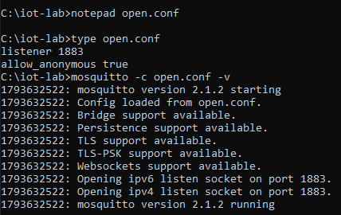

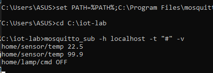

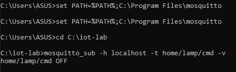

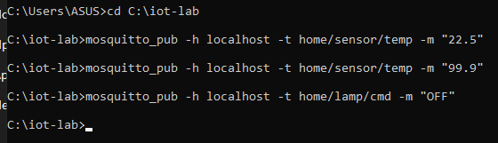

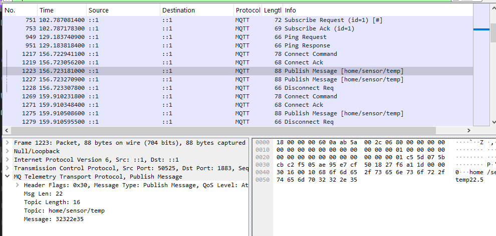

---

## Завдання 2. Захист через автентифікацію

### Створення користувачів

```
mosquitto_passwd -c passwd admin
mosquitto_passwd passwd sensor
mosquitto_passwd passwd lamp
```

| Користувач | Роль | Пароль (для лабораторної) |
|---|---|---|
| `admin` | Адміністратор | `AdminPass1` |
| `sensor` | Сенсорний пристрій | `SensorPass2` |
| `lamp` | Виконавчий пристрій | `LampPass3` |

### Конфігурація `auth.conf`

```
listener 1883
allow_anonymous false
password_file C:/iot-lab/passwd
```

### Проблема під час виконання

Спочатку анонімне підключення проходило (`CONNACK (0)`), бо на порту 1883 ще працював старий брокер із `open.conf`. Рішення: завершити всі процеси `mosquitto.exe` (cmd від імені адміністратора: `net stop mosquitto`, `taskkill /IM mosquitto.exe /F`), перевірити `netstat -ano | findstr :1883` і запустити лише `auth.conf`.

### Перевірка

Без пароля (очікується відмова):

```
mosquitto_pub -d -h localhost -t home/sensor/temp -m "22.5"
```

Результат: `CONNACK (5)`, `Connection Refused: not authorised`. У лозі брокера: `disconnected: not authorised`.

З правильними паролями:

```
mosquitto_sub -h localhost -u admin -P AdminPass1 -t "#" -v
mosquitto_sub -h localhost -u lamp -P LampPass3 -t home/lamp/cmd -v
mosquitto_pub -h localhost -u sensor -P SensorPass2 -t home/sensor/temp -m "23.1"
mosquitto_pub -h localhost -u admin -P AdminPass1 -t home/lamp/cmd -m "ON"
```

Результат: admin бачить `23.1` і `ON`, лампа отримує `ON`.

### Wireshark

У пакеті `Connect Command` ім'я користувача і пароль передаються **відкритим текстом** (на скріншоті спроба з `wrongpass`). Тобто паролі без шифрування каналу можна підслухати.

Скріншоти:

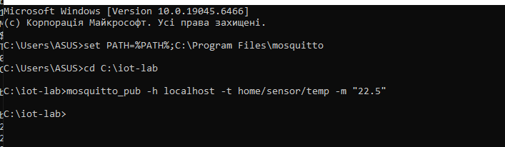

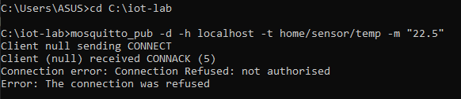

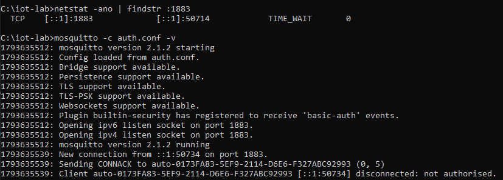

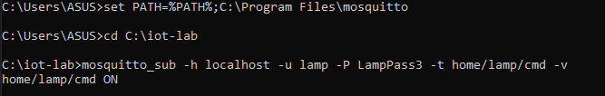

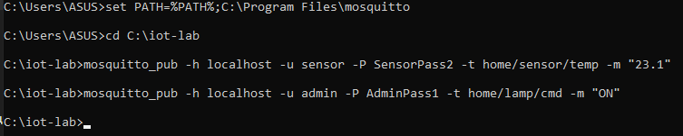

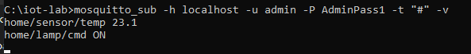

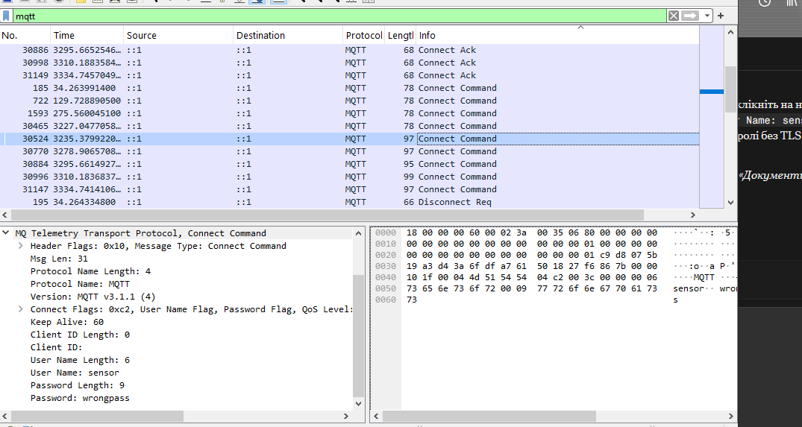

---

## Завдання 3. TLS/SSL шифрування

### Генерація сертифікатів

```
openssl genrsa -out ca.key 2048
openssl req -new -x509 -days 365 -key ca.key -out ca.crt -subj "/CN=MyIoT-CA"

openssl genrsa -out server.key 2048
openssl req -new -key server.key -out server.csr -subj "/CN=localhost"

echo subjectAltName=DNS:localhost,IP:127.0.0.1> san.ext
openssl x509 -req -in server.csr -CA ca.crt -CAkey ca.key -CAcreateserial -out server.crt -days 365 -extfile san.ext
```

Результат: `Certificate request self-signature ok`, `subject=CN=localhost`. Створено `ca.crt`, `ca.key`, `server.crt`, `server.key`.

> Примітка: спершу виникла помилка через змінну `OPENSSL_CONF`, що вказувала на неіснуючий `openssl.cfg`. Вирішено скиданням змінної: `set OPENSSL_CONF=`.

### Конфігурація `tls.conf`

```
listener 8883
cafile C:/iot-lab/ca.crt
certfile C:/iot-lab/server.crt
keyfile C:/iot-lab/server.key
tls_version tlsv1.2
allow_anonymous false
password_file C:/iot-lab/passwd
```

Брокер слухає лише порт **8883**, порт 1883 закрито.

```
mosquitto -c tls.conf -v
```

### Перевірка

Підключення з TLS і довіреним CA (успіх):

```
mosquitto_sub -h localhost -p 8883 --cafile ca.crt -u admin -P AdminPass1 -t "#" -v
mosquitto_pub -h localhost -p 8883 --cafile ca.crt -u sensor -P SensorPass2 -t home/sensor/temp -m "24.0"
mosquitto_pub -h localhost -p 8883 --cafile ca.crt -u admin -P AdminPass1 -t home/lamp/cmd -m "ON"
```

Результат: admin бачить `24.0` та `ON`, лампа отримує `ON`.

Підключення без довіреного CA (відмова):

```
mosquitto_pub -d -h localhost -p 8883 -u sensor -P SensorPass2 -t home/sensor/temp -m "22.5"
```

Результат: `certificate verify failed`, `Error: protocol error`. Клієнт не довіряє брокеру, що захищає від підміни сервера (MITM).

### Порівняння трафіку

| | Порт 1883 (без TLS) | Порт 8883 (TLS) |
|---|---|---|
| Протокол у Wireshark | MQTT | TLSv1.3 |
| Топіки та значення | Видно відкритим текстом | Не видно |
| Логін і пароль | Видно в `Connect Command` | Не видно |
| Вміст пакетів | Читається | Випадкові байти (`Application Data`) |

> Хоча в `tls.conf` вказано `tls_version tlsv1.2`, у Wireshark зафіксовано **TLSv1.3**: з'єднання узгодило новішу версію.

Скріншоти:

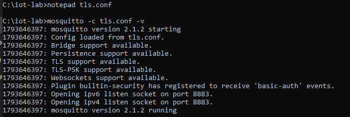

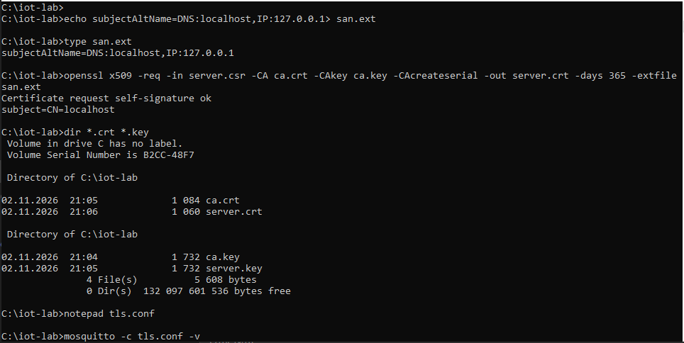

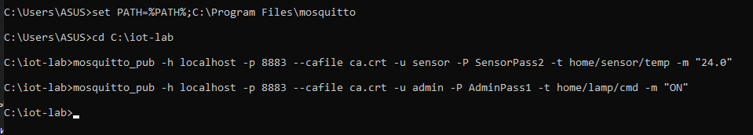

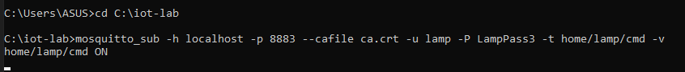

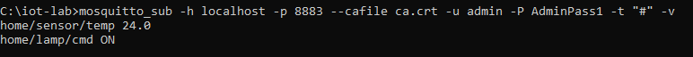

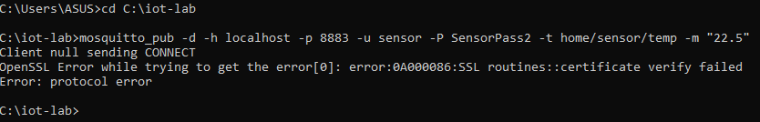

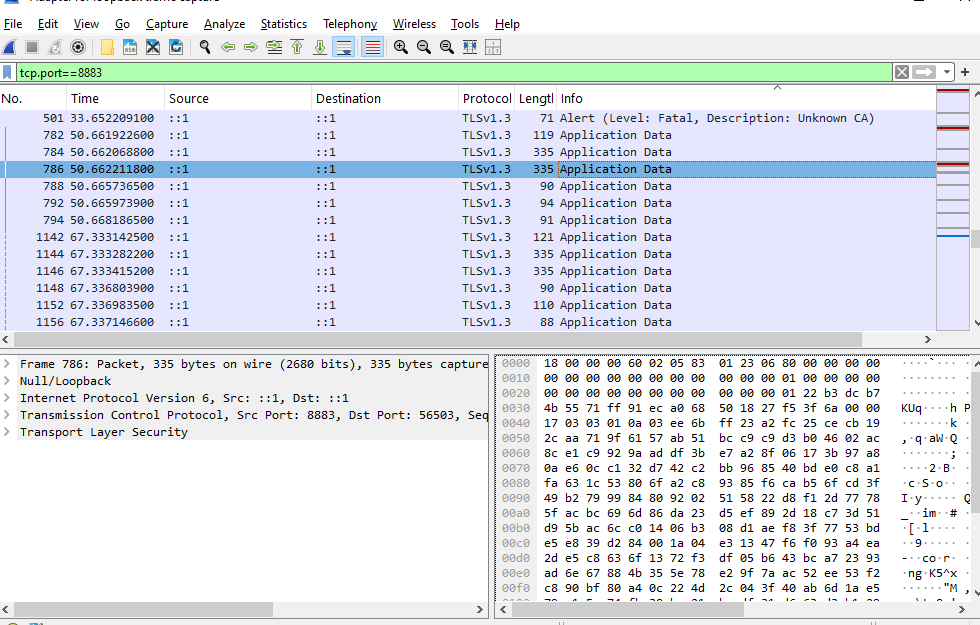

---

## Завдання 4. Аналіз і висновки

### Порівняльна таблиця

| Критерій | Без захисту | Тільки паролі | Паролі + TLS |
|---|---|---|---|
| Конфіденційність даних | Немає: усе відкритим текстом | Немає: дані та пароль видно у Wireshark | Є: лише TLS Application Data |
| Автентифікація клієнтів | Немає | Є: без пароля `not authorised` | Є, плюс захищений канал |
| Автентифікація брокера | Немає | Немає | Є: сертифікат, без CA `certificate verify failed` |
| Захист від MITM і підміни | Немає | Немає | Є |
| Складність налаштування | Мінімальна (2 рядки) | Низька (файл паролів) | Середня (CA, сертифікати, SAN, розповсюдження `ca.crt`, терміни дії) |
| Продуктивність | Найвища | Практично та сама | Трохи нижча (handshake, шифрування), помітно на слабких мікроконтролерах |
| Придатність для реального використання | Ні | Лише в ізольованій довіреній мережі | Так |

### Виявлені загрози в незахищеній IoT-системі

- **Прослуховування (sniffing):** підписка на `#` дала всі топіки й значення; у Wireshark дані читаються. За показниками можна визначити, чи є хтось удома.
- **Підміна даних (spoofing):** будь-який клієнт надіслав `99.9` від імені сенсора, і брокер це прийняв. Автоматика може ухвалити хибне рішення.
- **Несанкціоноване керування:** команда `OFF` вимкнула пристрій без перевірки. У реальній системі це можуть бути замки, реле, опалення.
- **Розвідка:** `#` та `$SYS/#` розкривають структуру системи й дані про брокер.
- **Крадіжка облікових даних:** без TLS логін і пароль видно в `Connect Command`.
- **MITM:** без TLS зловмисник між пристроєм і брокером може змінювати повідомлення.
- **DoS:** анонімний клієнт може засмітити брокер повідомленнями.

### Рекомендації для захисту IoT-пристроїв у домашній мережі

1. Змінити паролі за замовчуванням на всіх пристроях, використовувати унікальні й довгі.
2. Вимкнути анонімний доступ до брокера (`allow_anonymous false`).
3. Увімкнути TLS (порт 8883) і закрити порт 1883.
4. Налаштувати ACL за принципом мінімальних прав: кожен пристрій має доступ лише до своїх топіків (сенсор не керує лампою).
5. Винести IoT-пристрої в окрему мережу (VLAN або гостьовий Wi-Fi).
6. Не відкривати брокер в інтернет (без port forwarding); для віддаленого доступу використовувати VPN.
7. Регулярно оновлювати прошивки пристроїв і брокер.
8. Вимкнути непотрібні сервіси на пристроях (UPnP, telnet).
9. Для просунутих: клієнтські сертифікати (mTLS) замість паролів, моніторинг логів брокера.

## Висновок

Без захисту будь-хто в мережі може прослухати дані, підробити показники сенсорів і керувати пристроями. Паролі відповідають на питання «хто підключається», але не захищають канал: пароль передається відкритим текстом. TLS шифрує трафік і підтверджує справжність брокера. Достатній рівень захисту дає лише комбінація автентифікації (бажано з ACL) і TLS, за невеликої втрати продуктивності.


## Декларація використання ШІ
**Під час виконання роботи засоби штучного інтелекту не використовувались.**
